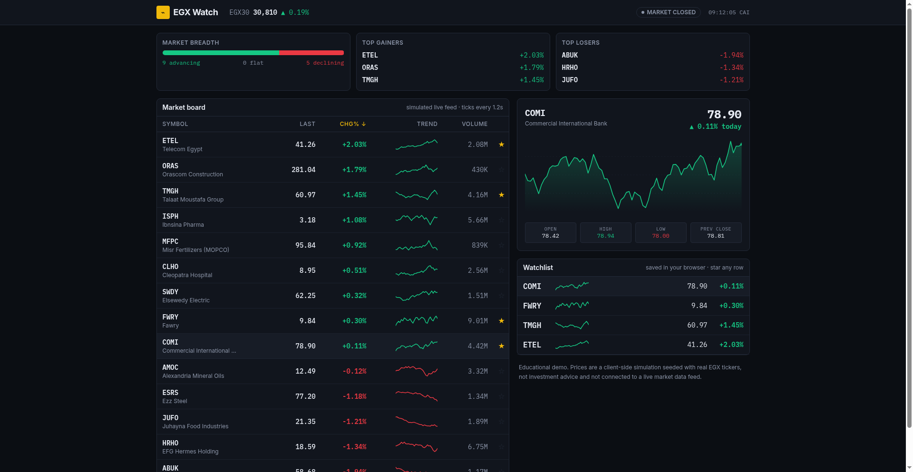

# ⌁ EGX Watch

A trading-terminal dashboard for the Egyptian Exchange. A live ticking market board with sparklines on every row, market breadth, top movers, an intraday detail chart and a personal watchlist that persists in the browser.



**Live demo:** https://malakmo7amed309.github.io/egx-watch/

## Standout feature

The whole board is alive: prices tick every second with green/red flash animations, every row carries its own sparkline, and the market breadth bar, top movers and the EGX30-style index recalculate with every tick. Click any ticker for a full intraday detail chart, and star names into a watchlist that survives reloads.

## What it does

- Live simulated feed seeded with 14 real EGX tickers (COMI, ETEL, SWDY, HRHO, TMGH, FWRY and more), driven by a mean-reverting random walk.
- Sortable market board: symbol, last price, change %, trend sparkline, volume.
- Market breadth meter (advancing / flat / declining) and top gainers / losers strips.
- Detail panel with intraday chart, open / high / low / previous close.
- Watchlist with one-click star, persisted in localStorage.
- Market session indicator follows real Cairo trading hours (Sun-Thu, 10:00-14:30).

## Stack

- React + Vite
- Tailwind CSS v4
- SVG charts drawn by hand, no chart library
- IBM Plex Mono tabular numerals, terminal-dark design

## Run locally

```bash
npm install
npm run dev
```

Educational demo: prices are a client-side simulation, not a live market data feed and not investment advice. The production build is a single self-contained `docs/index.html`, deployed to GitHub Pages from the `docs/` folder.
